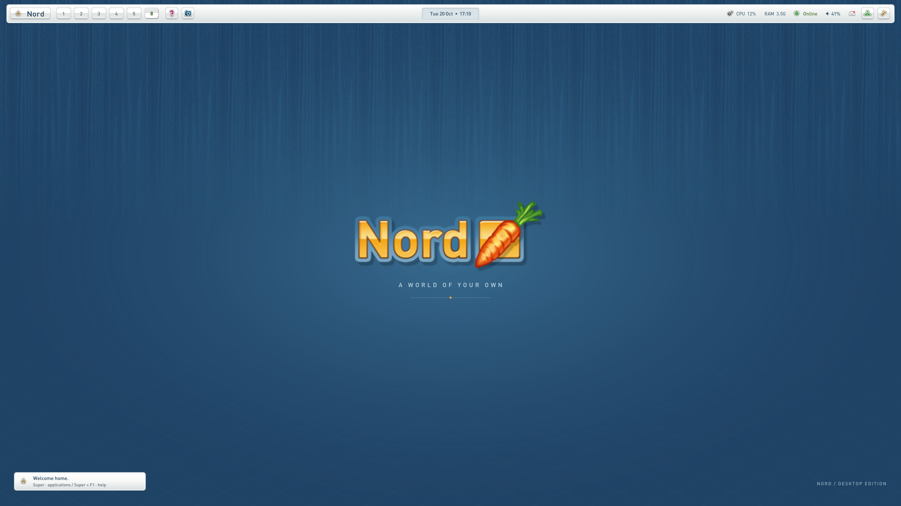
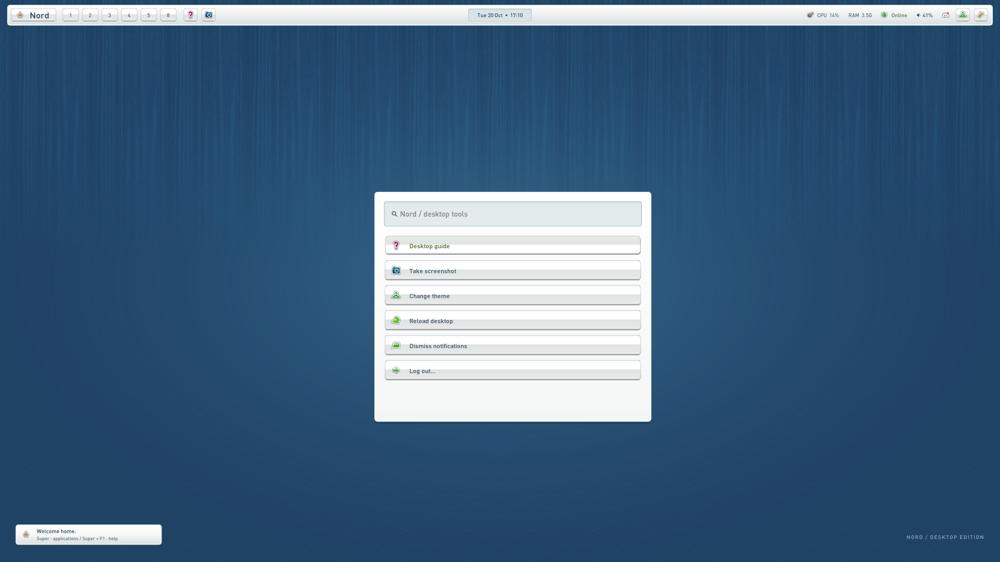
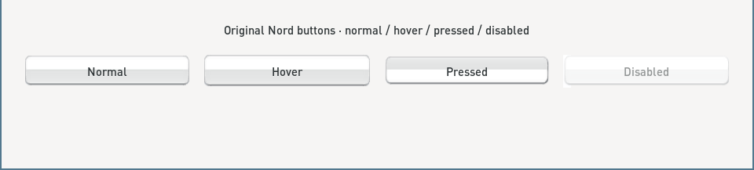

# Nord Sway

A Sway desktop inspired by Nord's original game interface: blue texture,
pearl panels, silver buttons, carrot-orange folders, and the original toolbar icons.



## The desktop

- Waybar with original home, help, camera, wardrobe, people, and tools artwork.
- Wofi application launcher and icon-based desktop tools.
- Original normal, hover, pressed, and disabled button textures.
- Transparent corners and seamless end caps, including at narrow workspace widths.
- Matching Foot, Mako, GTK and KDE color palettes.
- Editable wallpaper and an optional Papirus orange-folder overlay.
- Automatic local backups and a switch between Nord and your previous desktop.





## Install

Requires Linux with Sway, Waybar, Wofi, Mako (`makoctl`), Foot, Grim, Python 3.9+,
GLib's `gdbus`, `flock`, and `pkill`. Volume controls use `pactl` with PulseAudio
or PipeWire's PulseAudio compatibility service. Font Awesome supplies audio icons.
Papirus is optional; it supplies application icons and orange folders.
No root access is needed for the theme itself.

```sh
git clone https://github.com/JuggleWithTim/nord-sway.git
cd nord-sway
python3 install.py --dry-run
python3 install.py
```

The installer first snapshots every managed configuration file, including files
that were absent and existing symlinks. Backups stay under
`~/.local/state/nord-sway/backups/`; they are never part of this repository.
Configuration or Sway validation failures roll back the configuration.

This installs a complete Sway profile based on `/etc/sway/config`. Add keyboard,
monitor, and personal binding settings to `~/.config/sway/nord-local.conf`, which
the installer preserves. For example:

```sway
input type:keyboard xkb_layout se
output DP-1 resolution 2560x1440 scale 1
```

The default interface font is DejaVu Sans, or DIN-Medium when already available.
For the original game fonts, import them from your local game checkout:

```sh
python3 install.py --game-source /path/to/NordWebClient
```

Use `--game-source` on the first installation. The fonts are copied locally and
remain outside the repository. The pre-rendered wallpaper needs no rendering tools.

## Switch or restore

```sh
~/.local/bin/nord-theme restore  # restore the desktop saved before installing
~/.local/bin/nord-theme apply    # return to Nord
~/.local/bin/nord-theme toggle
~/.local/bin/nord-theme status
```

You can also click the wardrobe icon or use `Super+Shift+T` while Nord is active.
The previous desktop keeps its original bindings; the command above always lets
you switch back. Changes to either configuration are saved on the next switch.
Shared assets, helper commands and imported fonts remain installed after restore.
Existing applications stay open; some need reopening to pick up their new colors.

| Shortcut | Action |
| --- | --- |
| Super or Super+D | Applications |
| Super+Enter | Terminal |
| Super+F1 | Desktop guide |
| Super+Esc | Desktop tools |
| Super+Shift+T | Theme selector |
| Print | Screenshot to `~/Pictures/Screenshots` |
| Super+N / Super+Shift+N | Dismiss / restore notification |

Standard Sway workspace, movement, resize, and fullscreen shortcuts come from
the distribution's Sway config. Click volume to mute; scroll it to adjust sound.

## Files and customization

`config/` contains portable templates. The installer resolves `@HOME@`, `@BIN@`,
`@CONFIG@`, `@DATA@`, and `@UI_FONT@`; no machine-specific home directory is baked in.
XDG config, data, and state locations are respected.

- `config/sway/`: borders, gaps, bindings and local overrides.
- `config/waybar/` and `config/wofi/`: panels, controls and menus.
- `config/gtk-3.0/`, `config/gtk-4.0/`, `config/Nord.colors`: native palettes.
- `assets/`: copied game artwork, original and expanded button center strips,
  editable wallpaper SVG, and its ready-to-use PNG.
- `scripts/`: session tools, screenshot helper and reversible installer/switcher.

The center strip repeats the original pixel before scaling; each end cap overlaps
it by one pixel. This avoids fades or visible joins without adding white corner
backgrounds. `tools/render-assets.py` regenerates the strips and wallpaper using
Python Cairo, PyGObject and librsvg.

For a file-only preview in a disposable directory, without changing your session:

```sh
python3 install.py --target-home /tmp/nord-preview
python3 install.py restore --target-home /tmp/nord-preview
```

`--offline` installs into your normal home without reloading Sway or changing
GSettings. `python3 -m unittest discover -s tests -v` checks staged installation,
restoration, symlinks, and profile edits without touching your desktop.

## Credits

Inspired by the original Nord interface and assembled from the NordRevived game
assets. Original configuration, scripts and documentation are MIT licensed.
Game artwork and marks retain their existing rights; fonts and Papirus artwork
are not bundled. See [third-party notices](THIRD_PARTY_NOTICES.md).
